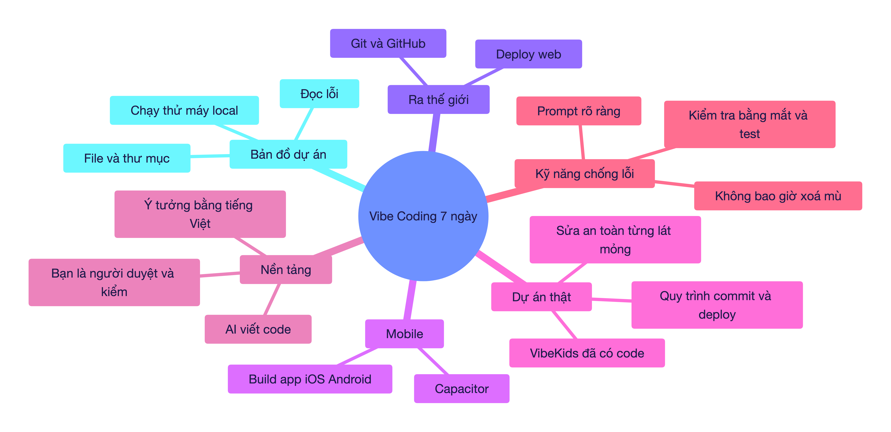
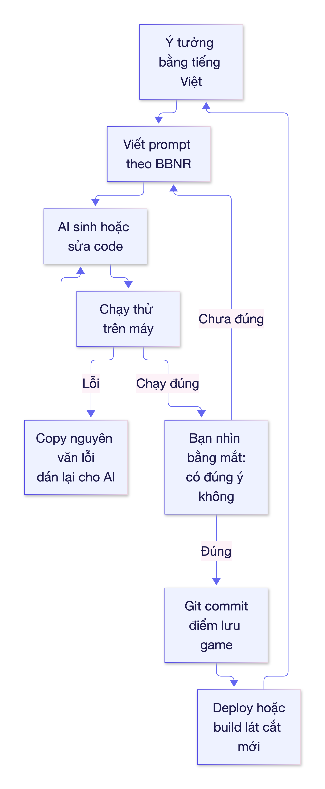
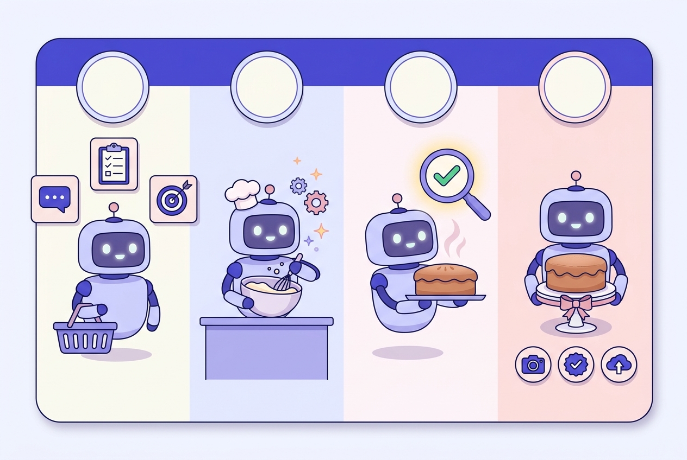
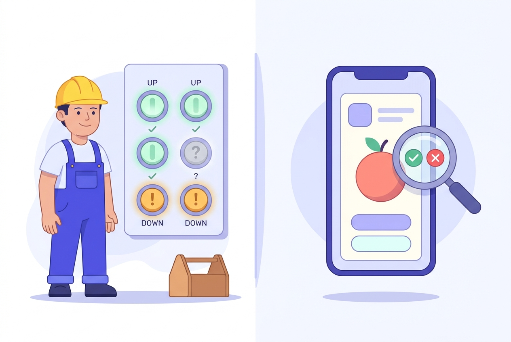

# 🎓 BUỔI 0 — HỢP ĐỒNG HỌC TẬP & BẢN ĐỒ LỘ TRÌNH VIBE CODING

> Giáo viên: Tutor (Principal Master Tutor). Học viên: bạn — **chưa biết gì về code**, mục tiêu **cả 3 hướng** (web app riêng → deploy công khai; app mobile; nâng cấp `english-for-kids`), nhịp **intensive 7 ngày × 60–90 phút**.
> Môi trường đã kiểm tra thực tế trên máy bạn: Node **v26.4.0**, pnpm **12.11.2**, git **2.50.1**, Python **3.9.6**; dự án `english-for-kids` đã có git repo `santabu107052/vibekids-english` (deploy qua `pnpm run deploy` → GitHub Pages).

---

## 📍 1. BẢN ĐỒ TRI THỨC TỔNG QUAN (VISUAL MINDMAP)

---

## 🎯 2. MỤC TIÊU BÀI HỌC (LEARNING OBJECTIVES — thang Bloom)

| Mức Bloom | Cuối 7 ngày bạn làm được |
| :--- | :--- |
| **Nhận biết** | Nói được vibe coding khác "học lập trình truyền thống" ở đâu; nhận ra 1 file trong dự án làm gì. |
| **Vận dụng** | Tự tạo 1 web app mới, chạy trên máy, đẩy lên GitHub, có link công khai. |
| **Phân tích** | Đọc thông báo lỗi trong Terminal và biết phải hỏi AI đúng câu gì. |
| **Sáng tạo** | Tự sửa/nâng cấp dự án `english-for-kids` theo từng lát mỏng, biết rollback khi hỏng. |

---

## 🧱 3. HỢP ĐỒNG HỌC TẬP (7 BUỔI × 60–90 PHÚT)

| Buổi | Chủ đề | Ra được sản phẩm gì | Bet |
| :--- | :--- | :--- | :--- |
| **1** | Vibe coding là gì + bảng điều khiển Terminal | Biết mở Terminal, chạy 1 dự án mẫu do AI tạo | Học viên sẽ tưởng "AI viết là xong" → chốt nguyên tắc *AI làm, bạn duyệt* |
| **2** | Bản đồ dự án: file, thư mục, `package.json`, `src/` | Đọc được cấu trúc `english-for-kids` bằng mắt | Sợ "code của người khác" → bóc 5 file quan trọng nhất trước |
| **3** | Prompt engineering trong vibe coding | Bộ 3 prompt mẫu: tạo mới / sửa lỗi / giải thích | Prompt mơ hồ = code sai → dạy công thức **Bối cảnh – Việc – Ràng buộc – Nghiệm thu** |
| **4** | Tự build web app mới từ số 0 (khung số 1) | App chạy `localhost` thật | Sợ "không ra gì" → khung số 1 chỉ có 1 nút bấm đổi màu |
| **5** | Git, GitHub, deploy web công khai | Link web ai cũng mở được | Lỡ hỏng là mất code → dạy commit như "điểm lưu game" |
| **6** | Mobile: Capacitor + build iOS/Android | Biết `cap sync`/`cap run` trên code VibeKids | Nghĩ app mobile phải viết lại từ đầu → hoá ra dùng lại web |
| **7** | Nâng cấp `english-for-kids` an toàn + nghiệm thu | 1 thay đổi thật được deploy, có kiểm thử | Xoá mù → quy tắc *lát cắt mỏng + kiểm + commit + deploy* |

**Khung số 1 (First Frame)** — dự án xuyên suốt 7 ngày:

> **"Bảng từ vựng tự học"**: 1 trang web hiện 1 từ tiếng Anh lớn ở giữa màn hình, 1 nút "Từ tiếp theo", 1 nút "Đổi màu nền". Vậy là đủ để học trọn vòng: **sửa code → chạy → commit → deploy**.

Vì sao không chọn luôn VibeKids làm dự án học? Vì nó đã có ~hàng chục file, có speech recognition, Capacitor, Ads — **quá xa vùng phát triển gần nhất (ZPD)** nếu là buổi 1. Buổi 4–5 bạn làm cái mới siêu nhỏ để hiểu toàn bộ vòng đời, buổi 6–7 mới quay lại dự án lớn.

---

## 🛠️ 4. TRỰC QUAN HÓA CƠ CHẾ VẬN HÀNH — VÒNG LẶP VIBE CODING

**Công thức prompt BBNR** (dùng ở Buổi 3, nhưng nhìn trước cho dễ hình dung):

| Chữ | Nghĩa | Ví dụ |
| :--- | :--- | :--- |
| **B** | Bối cảnh | "Dự án React ở thư mục english-for-kids" |
| **B** (2) | Việc cần làm | "Thêm nút Từ tiếp theo" |
| **N** | Ràng buộc | "Không sửa file nào ngoài `src/App.tsx`, giữ nguyên style" |
| **R** | Nghiệm thu | "Nhấn nút thì đổi sang từ kế tiếp, không lỗi console" |

**Nhìn trước: prompt BBNR giống như một công thức nấu ăn 🍰**

*Đọc ảnh theo chiều trái sang phải: **(1) Nguyên liệu** = bạn nói rõ ý tưởng, ràng buộc và cách nghiệm thu; **(2) Nấu** = AI viết/sửa code; **(3) Kiểm tra bánh** = chạy test và nhìn bằng mắt; **(4) Dọn ra bàn** = chụp ảnh, gắn huy hiệu "đã kiểm", đẩy lên web. Đang nấu mà không ai nhìn lại bánh thì bánh vẫn cháy đẹp như thường — đó chính là kiểu "code chạy nhưng sai ý".*

---

## 📊 5. BẢNG SO SÁNH — VIBE CODING vs HỌC LẬP TRÌNH TRUYỀN THỐNG

| Tiêu chí | Học lập trình truyền thống | Vibe coding (bạn chọn) |
| :--- | :--- | :--- |
| Ai viết code | Bạn, từng dòng | AI viết, bạn tả và duyệt |
| Tốc độ ra sản phẩm | Hàng tháng | Hàng giờ |
| Kiến thức cần trước | Cú pháp, thuật toán, cấu trúc dữ liệu | Ý tưởng rõ ràng, biết đọc lỗi, biết kiểm chứng |
| Rủi ro chính | Nản vì lý thuyết dài | **Tin AI mù** → code chạy nhưng sai ý, hoặc hỏng dự án |
| Thứ vẫn phải học | Tất cả | Bản đồ dự án, git rollback, đọc lỗi, nghiệm thu |
| Cách kiểm đúng/sai | Test viết tay | **Bạn nhìn bằng mắt + AI viết test + chạy thật** |

> ⚠️ Điểm cốt lõi của cả khóa: **Vibe coding không phải "nhờ AI rồi thôi". Nó là "dùng AI nhanh gấp 10, nhưng bạn là người chịu trách nhiệm cuối".** Ai bỏ qua bước kiểm chứng sẽ nhận về dự án chạy được hôm nay, hỏng ngày mai.

---

## 🎯 6. TỰ KIỂM TRA HIỂU BÀI (CHECK FOR UNDERSTANDING)

> **Nhớ mãi khái niệm "test":** hãy tưởng tượng một bác thợ điện đi kiểm tra **từng công tắc** trong ngôi nhà vừa sửa xong — công tắc nào bật lên cũng có đèn sáng là chứng minh "điện vẫn đi tới mọi ngõ". Đó chính là việc test tự động làm với code của bạn.

*Bên trái: mỗi công tắc = một tính năng, xanh còn sáng đèn nghĩa là tính năng cũ chưa bị bạn làm hỏng. Bên phải: điện thoại hiện app "trông có vẻ ổn" nhưng kính lúp vẫn thấy **dấu X đỏ** — nhắc bạn rằng test xanh chưa đủ, vẫn phải tự nhìn.*

1. **Câu hỏi 1:** Nếu AI viết xong một chức năng, tại sao vẫn phải "chạy thử bằng mắt"?
2. **Câu hỏi 2:** Vì sao 2 buổi đầu ta không đụng ngay vào `english-for-kids`?
3. **Câu hỏi 3:** Trong vòng lặp ở mục 4, khi AI sửa sai ý bạn, bước nào lặp lại?

💡 Xem gợi ý đáp án

1. Vì AI có thể sinh code **chạy không lỗi nhưng sai yêu cầu** (ví dụ nút "Từ tiếp theo" lại quay về từ đầu). Chỉ bạn biết "đúng ý" là gì.
2. Vì nó quá lớn so với nền hiện tại (ZPD) — dễ hoa mắt, dễ làm hỏng và mất niềm tin. Học trên khung nhỏ trước rồi mới quay lại.
3. Quay về **B: viết lại prompt** (rõ Bối cảnh / Ràng buộc / Nghiệm thu), không sửa mò trong code.

---

## 📌 7. LỘ TRÌNH ÔN TẬP & BƯỚC TIẾP THEO

- 🗓️ **Ôn 1 (sau 1 ngày):** nhớ lại 4 chữ **BBNR** và 3 nhánh của vòng lặp vibe coding (ảnh ý → prompt → chạy & kiểm).
- 🗓️ **Ôn 2 (sau 3 ngày):** giải thích bằng lời của bạn, trong 60 giây, cho một người khác nghe "vibe coding là gì và vì sao AI vẫn cần bạn duyệt" (Feynman).
- 🗓️ **Ôn 3 (sau 7 ngày):** bạn sẽ tự trải qua đúng 3 rủi ro này và đối chiếu — nếu chưa gặp, ta sẽ gài vào bài tập.
- 🚀 **Bước tiếp theo:** **Buổi 1 — "Mở Terminal lần đầu: chạy một dự án do AI tạo"**. Bạn chỉ cần ngồi trước máy, không cần cài gì thêm.
- 🃏 **Thẻ ôn tập:** xem `../the-on-tap/bo-the-on-tap-buoi-0.txt` (import vào Anki: File ➔ Import; nguồn soạn thẻ là `../the-on-tap/bo-the-on-tap-buoi-0.csv`).
