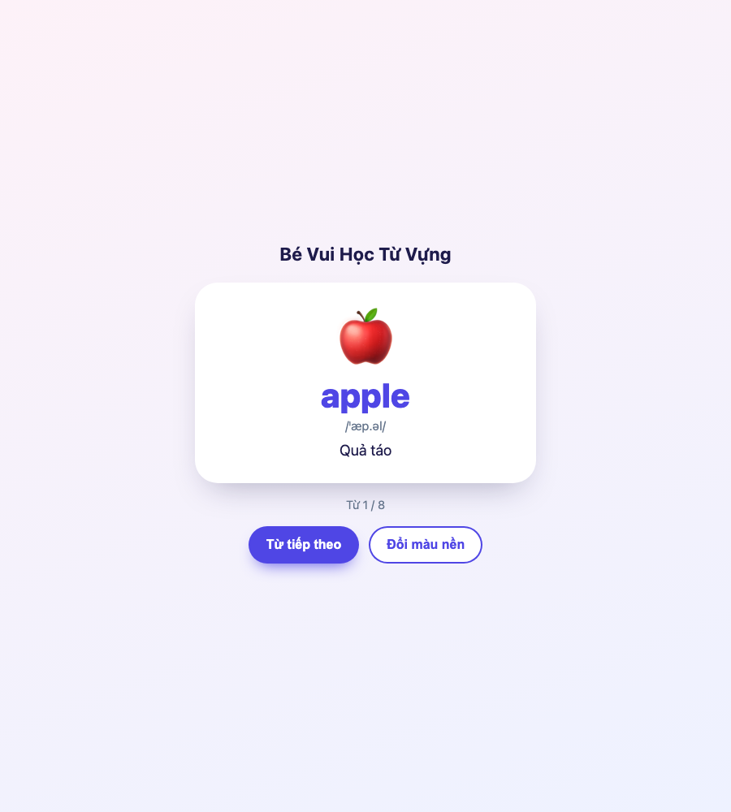
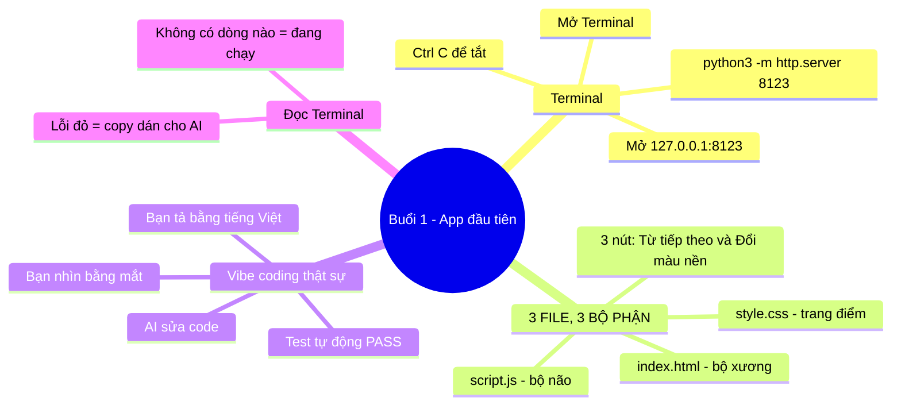
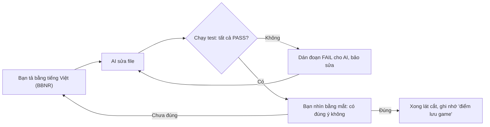
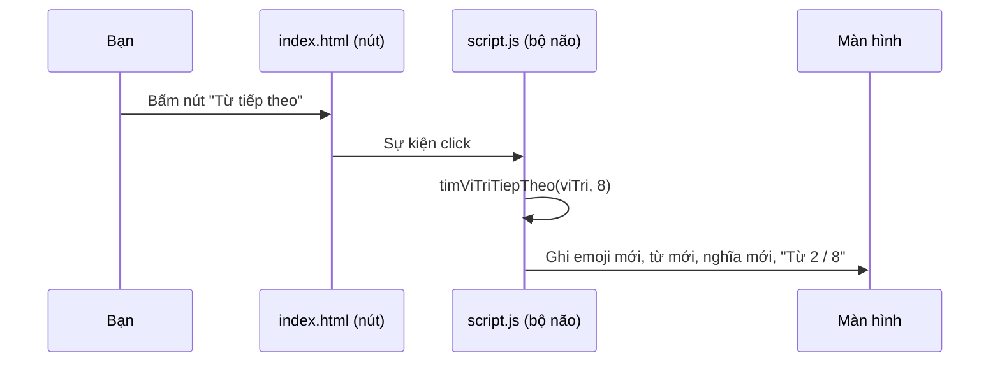

# 🎓 BUỔI 1 — MỞ CỬA LẦN ĐẦU: APP "BÉ VUI HỌC TỪ VỰNG" ĐÃ CHẠY

> **Học viên:** chưa biết gì về code · **Nhịp:** 60–90 phút · **Dự án:** `the-tu-vung-mini` (khung số 1, đã dựng sẵn và **đã kiểm chứng chạy thật**)
> **Kết thúc buổi:** bạn mở được app bằng Terminal, hiểu 3 file là 3 bộ phận, và tự làm **bài tập BBNR đầu tiên**.



> Ảnh trên là ảnh chụp **thật** của app, lấy bằng trình duyệt Chrome tự động ngày 14/11/2026 — không phải hình minh họa.

---

## 📍 1. BẢN ĐỒ TRI THỨC TỔNG QUAN (VISUAL MINDMAP)



**Bản đồ ASCII** (nếu nơi bạn đọc không render Mermaid):

```text
Buổi 1 - App đầu tiên
├── Terminal
│   ├── Mở Terminal
│   ├── python3 -m http.server 8123
│   ├── Mở http://127.0.0.1:8123
│   └── Ctrl + C để tắt
├── 3 FILE, 3 BỘ PHẬN
│   ├── index.html  — bộ xương (những gì TỒN TẠI trên trang)
│   ├── style.css   — trang điểm (ĐẸP hay không đẹp)
│   └── script.js   — bộ não (CHẠY thế nào khi bấm nút)
└── Vibe coding thật sự
    ├── Bạn tả bằng tiếng Việt (prompt BBNR)
    ├── AI sửa code
    ├── Test tự động PASS
    └── Bạn nhìn bằng mắt xác nhận
```

---

## 🌐 1b. BẢN LIVE CÔNG KHAI (Tutor đã triển khai thật — 14/11/2026)

| Trang | Link (bấm được) |
| :--- | :--- |
| Trang chủ khoá học | https://santabu107052.github.io/vibekids-english/khoa-hoc-vibe-coding/ |
| App khung số 1 | https://santabu107052.github.io/vibekids-english/khoa-hoc-vibe-coding/the-tu-vung-mini/ |
| Tài liệu buổi 1 | https://santabu107052.github.io/vibekids-english/khoa-hoc-vibe-coding/tai-lieu/buoi-1-mo-terminal-va-3-file.md |
| Bộ thẻ ôn tập | https://santabu107052.github.io/vibekids-english/khoa-hoc-vibe-coding/the-on-tap/bo-the-on-tap-buoi-1.txt |

> Tutor đã kiểm tra thực tế: **8/8 URL trả về 200**, và mở app bằng Chrome tự động đọc được đúng `apple / Quả táo / Từ 1 / 8`. Tức là buổi 5 (deploy) bạn đã được "xem trước đích đến" ngay từ hôm nay. Vẫn giữ nguyên bài tập Bước A trên máy để bạn **tự tay làm** — xem app chạy trên web thì quen mắt sẽ sợ Terminal.

---

## 🎯 2. MỤC TIÊU BÀI HỌC

- **Kiến thức:** biết Terminal là gì; biết mỗi file trong app có nhiệm vụ gì.
- **Kỹ năng:** tự mở app bằng 1 câu lệnh; tự chạy **test** bằng 1 câu lệnh; biết đóng app.
- **Thái độ:** hết sợ Terminal — vì Terminal chỉ là nơi bạn **giao việc** cho máy bằng chữ.

---

## 🧱 3. GIẢNG GIẢI CẶN KẼ TỪNG KHỐI KIẾN THỨC

### 🔹 Khối 1: Terminal — "cửa khẩu giao việc cho máy"

- **Ẩn dụ trực quan:** Cửa hàng có 2 kiểu khách: khách **bấm chuột** (giao diện) và khách **đọc đơn hàng bằng giọng nói rõ ràng** (Terminal). Các lập trình viên chuyên nghiệp dùng kiểu thứ 2 vì **nhanh hơn** và **máy nào cũng có**.
- **Định nghĩa chuẩn:** *Terminal* là cửa sổ cho phép bạn gõ **câu lệnh** (command) bằng chữ để ra lệnh cho máy tính, thay vì bấm chuột.
- **Ví dụ cụ thể:** gõ `python3 -m http.server 8123` nghĩa là hỏi máy: *"Bạn Python ơi, làm ơn mở cửa hàng web (http server) ở **quầy số 8123** giúp tôi"*. Máy mở quầy, bạn vào bằng địa chỉ `http://127.0.0.1:8123`.
- **⚠️ Hiểu sai phổ biến:** nghĩ Terminal **giống hệt** một trang web. Không: Terminal là **một chương trình riêng**. Trong Terminal bạn gõ **tên app** (*Terminal*, được macOS gọi tên là *Terminal*), không gõ code.

---

### 🔹 Khối 2: Ba file = ba bộ phận của một con người

- **Ẩn dụ trực quan:** một con người = **xương** + **quần áo & trang điểm** + **bộ não**. Thiếu bộ não vẫn nhìn thấy "người" nhưng không biết ai là ai; thiếu xương thì không đứng được.

| Bộ phận | File | Nhiệm vụ | Trong app của mình |
| :--- | :--- | :--- | :--- |
| Bộ xương | `index.html` | Khai báo **cái gì có trên trang** | 1 thẻ trắng, 2 nút, các chỗ trống: `id="tu-tieng-anh"` |
| Trang điểm | `style.css` | Quyết định **đẹp hay xấu** | Bo góc tròn, chữ to, 4 bộ màu nền |
| Bộ não | `script.js` | Quyết định **bấm nút thì chuyện gì xảy ra** | "Từ tiếp theo" → sang từ kế, "Đổi màu nền" → đổi màu |

- **Định nghĩa chuẩn:**
  - *HTML* = ngôn ngữ đánh dấu (**H**yper**T**ext **M**arkup **L**anguage) — mô tả các khối nội dung.
  - *CSS* = ngôn ngữ trang trí (**C**ascading **S**tyle **S**heets) — mô tả màu, cỡ, vị trí.
  - *JavaScript* = ngôn ngữ lập trình — mô tả hành vi, "khi X thì làm Y".
- **Ví dụ cụ thể:** file `index.html` có dòng `<div class="word" id="tu-tieng-anh">apple</div>`. Chữ `apple` ở đây chỉ là **giá trị tạm**; ngay khi mở app, `script.js` sẽ **ghi đè** bằng từ đúng hơn (`apple`) và tiếp theo là `cat`, `banana`… Vì thế nếu bạn sửa chữ `apple` trong HTML mà **không** thấy đổi — bình thường, vì bộ não ghi đè lại.
- **⚠️ Hiểu sai phổ biến:** *"Tôi sửa chữ trong HTML mà app không đổi, chắc app hỏng."* Không hỏng — bạn đang sửa sai bộ phận: chữ hiển thị do **script.js** điều khiển (danh sách `BO_TU_MAU`). Sửa HTML chỉ hữu ích với thứ **không** bị JS ghi đè (ví dụ tiêu đề "Bé Vui Học Từ Vựng").

---

### 🔹 Khối 3: `id` — "tên gọi" để bộ não tìm đúng bộ phận

- **Ẩn dụ trực quan:** Một lớp 40 em đều mặc áo trắng. Cô giáo gọi "Bạn có **số báo danh 12**" — không gọi "bạn áo trắng ơi" (sẽ 40 em quay lại). `id` chính là số báo danh.
- **Định nghĩa chuẩn:** `id` là **một thuộc tính HTML** gán **một định danh duy nhất** cho phần tử (element), để code hay CSS tìm đúng phần tử đó.
- **Ví dụ cụ thể:**

```text
index.html:  <div id="emoji">🍎</div>
script.js :  tim('emoji').textContent = tu.emoji;   // ghi vào đúng chỗ đó
```

  Đổi tên `id` ở file này mà **không đổi** ở file kia → bộ não gõ cửa "phòng có số báo danh `emoji`" và **không ai trả lời** → nút bấm không làm gì. Đây là **lỗi số 1** của người mới dùng vibe coding.
- **⚠️ Hiểu sai phổ biến:** nghĩ `class` (dùng ở `style.css`: `.card`, `.btn`) và `id` (dùng ở `script.js`: `tim('emoji')`) là một thứ. Không: `class` là **nhóm** (nhiều phần tử dùng chung 1 kiểu, ví dụ mọi nút), `id` là **duy nhất** (chỉ 1 phần tử).

---

### 🔹 Khối 4: Test — "người gác cổng" cho phép bạn sửa code mà không sợ

- **Ẩn dụ trực quan:** Bạn cải tạo nhà. Trước khi làm xong, người gác cổng **lần lượt bật từng công tắc** trong nhà để chắc "công tắc nào cũng bật được". Có test, bạn được phép **bấm, sửa, làm hỏng thử** — vì gác cổng sẽ báo ngay.
- **Định nghĩa chuẩn:** *Test* (kiểm thử) là đoạn code **tự động chạy thử** tính năng và trả về **PASS/FAIL**. Chạy lại test **sau mỗi lần sửa** để chắc không làm hỏng chức năng cũ gọi là **kiểm thử hồi quy** (regression testing).
- **Ví dụ cụ thể:** dự án có 10 test. Hôm nay AI sửa nút "Từ tiếp theo" và làm hỏng luật quay vòng → test thứ 9 (`bấm đủ 8 lần thì vòng lại từ đầu`) **chuyển sang FAIL**. Bạn **copy dòng FAIL dán cho AI** — "sửa cho test này PASS". AI có **mục tiêu cụ thể**, không đoán mò.
- **⚠️ Hiểu sai phổ biến:** *"Test PASS nghĩa là app đẹp, đúng ý."* Sai. Test chỉ kiểm **chức năng** (bấm ra gì), **không** kiểm **thẩm mỹ**. Vẫn phải tự nhìn bằng mắt.

---

### 🔹 Khối 5: Vibe coding thật sự — 4 bước, không phải 1 bước

> Người mới thường nghĩ: *"Tả cho AI → AI code → xong"*. Đó là **1 bước**, và là cách nhanh nhất để có một app **chạy được nhưng sai**.



---

## 🛠️ 4. TRỰC QUAN HÓA CƠ CHẾ: ĐIỀU GÌ XẢY RA KHI BẠN BẤM "TỪ TIẾP THEO"



---

## 📊 5. BẢNG SO SÁNH — 3 FILE DỄ NHẦM

| Tiêu chí | `index.html` | `style.css` | `script.js` |
| :--- | :--- | :--- | :--- |
| Trả lời câu hỏi | **Có gì** trên trang? | Trông **thế nào**? | **Làm gì** khi bấm? |
| Đơn vị cơ bản | Thẻ (element) như `<div>`, `<button>` | Quy tắc (rule) như `.btn { }` | Hàm (function) như `mauTiepTheo()` |
| Người mới sửa khi muốn… | Đổi tiêu đề, thêm 1 nút | Đổi màu, cỡ chữ, bo góc | Thêm quy tắc, thêm từ vựng |
| Sửa sai file sẽ… | Lỗi hiển thị / mất nút | Không hỏng chức năng | Phá chức năng nhưng vẫn "đẹp" |
| Ai kiểm được? | Bạn nhìn | Bạn nhìn | **Test tự động** |

---

## 🎯 6. BÀI TẬP THỰC HÀNH BẮT BUỘC (làm ngay trong buổi)

### Bước A — Mở app (5 phút)

1. Mở **Terminal** (search "Terminal" trong Spotlight ➔ Enter).
2. Gõ **từng dòng** dưới đây rồi Enter:

```bash
cd /Users/santabu/Documents/deepseek-harness/default-workspace/english-for-kids/khoa-hoc-vibe-coding/the-tu-vung-mini
python3 -m http.server 8123
```

3. Terminal sẽ **đứng im** (không có dòng mới). **Đó là BÌNH THƯỜNG** — Terminal đang "trực quầy".
4. Mở Chrome ➔ dán vào thanh địa chỉ: `http://127.0.0.1:8123`
5. Bấm **"Từ tiếp theo"** 3 lần (phải thấy `cat` → `banana` → `dog`), bấm **"Đổi màu nền"** 2 lần.
6. Xong thì quay lại Terminal bấm **Ctrl + C** để tắt.

> ⚠️ Nếu ở bước 3 Terminal **in ra dòng đỏ** `Address already in use` — nghĩa là quầy 8123 đã bị chiếm. Đổi số: `python3 -m http.server 8124` và mở `127.0.0.1:8124`.

### Bước B — Chạy test (2 phút)

Trong Terminal, **Ctrl + C** trước cho sạch, rồi gõ:

```bash
cd /Users/santabu/Documents/deepseek-harness/default-workspace/english-for-kids/khoa-hoc-vibe-coding/the-tu-vung-mini
node --test test/khoa-hoc.test.mjs
```

Bạn phải thấy **`pass 10` / `fail 0`**. Con số `10` này là **vạch mốc của bạn**: mọi lần sửa code sau, test phải vẫn `10/10` mới được coi là "chưa làm hỏng gì".

### Bước C — Bài tập vibe coding ĐẦU TIÊN (10 phút)

> **Yêu cầu:** thêm 1 nút thứ ba tên **"Quay lại từ trước"**, bấm thì lùi 1 từ; đang ở từ đầu thì nhảy về **từ cuối** (ngược của "Từ tiếp theo").

Nhưng — **bạn chưa tự viết code**. Bạn viết **prompt BBNR** rồi **dán vào ô chat với tôi**. Tôi sẽ sửa code chạy thật, sau đó bạn chạy lại test và tự bấm thử.

**Khuôn mẫu để bạn điền (copy khuôn này, sửa chỗ ngoặc vuông):**

```text
B — Bối cảnh: Dự án nhỏ ở thư mục khoa-hoc-vibe-coding/the-tu-vung-mini
    gồm index.html, style.css, script.js và test/khoa-hoc.test.mjs (10 test đang PASS).
V — Việc: Thêm nút thứ ba "Quay lại từ trước" cạnh 2 nút hiện có. Bấm thì hiện từ
    phía trước; đang ở từ đầu (Từ 1/8) thì nhảy về từ cuối (Từ 8/8).
N — Ràng buộc: Không đổi giao diện hiện tại, không đổi màu, không xoá nút cũ.
    Nút mới dùng cùng kiểu .btn như nút "Đổi màu nền".
    Thêm hàm thuần `timViTriTruoc(viTriHienTai, tongSoTu)` trong script.js.
R — Nghiệm thu: Thêm 3 test mới (bình thường / từ đầu nhảy về cuối / dữ liệu rác).
    Chạy `node --test test/khoa-hoc.test.mjs` phải ra pass 13, fail 0.
    Bấm thử trên trình duyệt: từ apple ➔ quay lại thì ra rice (Từ 8/8).
```

**Nộp bài:** dán prompt vừa điền vào chat. Tôi sẽ làm **đúng vai AI code** (như bạn sẽ làm với AI khác), rồi bạn chạy `node --test` để **tự nghiệm thu**.

---

## 🎯 7. TỰ KIỂM TRA HIỂU BÀI (CHECK FOR UNDERSTANDING)

1. **Câu hỏi 1:** Bạn muốn đổi tiêu đề "Bé Vui Học Từ Vựng" thành "Bé Học Từ Vựng Vui" — sửa file nào?
2. **Câu hỏi 2:** Bạn muốn app đẹp hơn: từ to hơn, thẻ bo tròn hơn — sửa file nào?
3. **Câu hỏi 3:** Bạn sửa chữ `apple` trong `index.html` thành `APPLE` nhưng mở app vẫn thấy `apple` — hỏng hay không hỏng? Vì sao?
4. **Câu hỏi 4:** Terminal đang ở trạng thái "đứng im" sau khi gõ `python3 -m http.server 8123`, có cần bấm gì tiếp không?

<details><summary>💡 Xem gợi ý đáp án</summary>

1. `index.html` (tiêu đề không bị bộ não ghi đè).
2. `style.css`.
3. **Không hỏng.** `script.js` chạy sau và ghi đè chữ bằng dữ liệu trong `BO_TU_MAU`.
4. **Không.** "Đứng im" = đang chạy. Bấm **Ctrl + C** khi muốn tắt.
</details>

---

## 📌 8. LỘ TRÌNH ÔN TẬP & BƯỚC TIẾP THEO

- 🗓️ **Ôn 1 (sau 1 ngày):** mở app bằng **2 dòng lệnh** không nhìn lại bài. Nếu quên → xem lại Bước A.
- 🗓️ **Ôn 2 (sau 3 ngày):** giải thích bằng lời: "HTML là xương, CSS là áo, JS là não" + `id` là số báo danh.
- 🗓️ **Ôn 3 (sau 7 ngày):** chạy test và nói được vì sao `pass 10` quan trọng hơn "trông đẹp".
- 🚀 **Bước tiếp theo:** hoàn thành Bài tập 6.C → **Buổi 2: Bản đồ dự án VibeKids** (đọc `App.tsx`, `curatedWords.ts`, `package.json` và hiểu vì sao bấm "Từ tiếp theo" trong VibeKids lại phức tạp hơn trong app của mình).
- 🃏 **Thẻ ôn tập:** `../the-on-tap/bo-the-on-tap-buoi-1.txt` (import Anki: File ➔ Import).

---

## 📎 PHỤ LỤC — 5 câu lệnh bạn dùng suốt khóa

| Việc | Câu lệnh |
| :--- | :--- |
| Vào thư mục dự án | `cd /duong/dan/thu-muc` |
| Mở app học (khung số 1) | `python3 -m http.server 8123` → mở `http://127.0.0.1:8123` |
| Chạy test | `node --test test/khoa-hoc.test.mjs` |
| Tắt app | Ctrl + C |
| Xem mình đang ở đâu | `pwd` |
