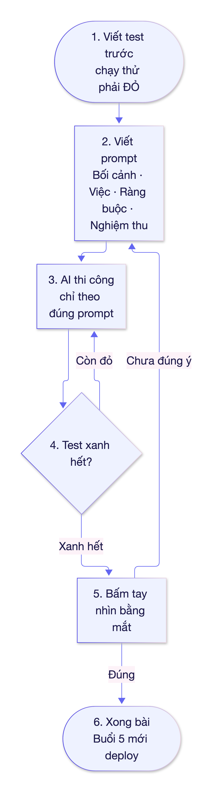

# 📒 SỔ TAY TRA NHANH — BUỔI 0 & BUỔI 1

> Không phải bài giảng mới. Đây là **trang tra cứu 30 giây** khi bạn quên một khái niệm.
> Mỗi mục: **định nghĩa 1 câu → ví dụ thật từ app của bạn → câu chốt phải nhớ**.

---

## 🔑 1. BVRN — công thức prompt (quên là mở đây)

| Nhãn | Nghĩa | Trả lời câu hỏi | Ví dụ từ bài tập D của bạn |
| :--- | :--- | :--- | :--- |
| **B** | Bối cảnh | Đang ở đâu, có gì? | "App ở thư mục the-tu-vung-mini, có 10 test đang PASS" |
| **V** | Việc | Muốn làm gì? | "Thêm nút thứ ba 'Quay lại từ trước'…" |
| **R** | Ràng buộc | Không được làm gì? | "Không đổi giao diện, không xoá nút cũ, dùng class `.btn`" |
| **N** | Nghiệm thu | Làm sao biết là đúng? | "5 test mới xanh + 10 test cũ vẫn xanh + bấm tay apple → rice" |

**Câu chốt:** tên đúng là **BVRN**, không phải BBNR. Thiếu **R** = AI tự do sáng tạo (hôm nay: nó sẽ tự vẽ giao diện nút mới).

---

## 🎯 2. Luật chơi khi cho AI sửa code (đỏ trước — xanh sau)



**Câu chốt:** "**Đỏ trước → xanh sau → bấm tay nhìn**". Không có bước "đỏ trước" nghĩa là bạn đang sửa mò.

---

## 🦴 3. Ba file = ba bộ phận (mở app ra là nhớ)

| Bộ phận | File | Trả lời | Sửa khi muốn |
| :--- | :--- | :--- | :--- |
| Xương | `index.html` | Có gì trên trang? | Đổi tiêu đề, thêm nút, thêm chỗ trống `id` |
| Áo | `style.css` | Trông thế nào? | Màu, cỡ chữ, bo góc |
| Não | `script.js` | Bấm thì làm gì? | Thêm từ vựng, thêm nút, đổi luật |

**Câu chốt:** sửa chữ trong HTML mà app không đổi → **không hỏng**, do `script.js` chạy sau và ghi đè.

---

## 🏷️ 4. `id` — số báo danh

`<div id="emoji">🍎</div>` ← xương khai báo · `tim('emoji').textContent = …` ← não tìm tới.

**Câu chốt:** đổi `id` ở một file mà quên file kia → nút bấm "gõ cửa phòng không có ai" → **lỗi số 1 của người mới**.

---

## 🧪 5. Test — người gác cổng (giống bác thợ điện bật thử từng công tắc)

- `node --test test/khoa-hoc.test.mjs` → 10 test gốc, phải **10/10** sau mỗi lần sửa.
- `node --test _bai-tap-d/test/nghiem-thu.mjs` → 5 test của bài tập nút "Quay lại".

**Câu chốt:** **test xanh KHÔNG chứng minh app đúng ý.** Test chạy trên "trang giả"; xoá `div#emoji` vẫn xanh nhưng app sẽ lỗi. Vì vậy **luôn bấm tay nhìn bằng mắt**.

---

## 💻 6. Terminal — 3 kiểu "im lặng" phải phân biệt

| Bạn thấy | Nghĩa | Xử lý |
| :--- | :--- | :--- |
| Dấu nhắc `~ %` chờ sẵn, gõ không hiện chữ | Terminal chưa nhận phím / đang bôi đen | Click vào vùng trắng, bấm `Esc` |
| Chạy xong, **không in gì**, dấu nhắc quay lại | **Thành công mà không có gì để báo** | Không phải lỗi |
| Dấu nhắc **không quay lại** | Cửa sổ đang bận (ví dụ `python3 -m http.server`) | **Ctrl + C** để nhả ra |

**Câu chốt:** trước khi chạy lệnh mới, hỏi *"dấu nhắc đã quay lại chưa?"*.

---

## 📜 7. Đọc log — 200, 404, lỗi đỏ

| Dòng | Nghĩa |
| :--- | :--- |
| `"GET / 200"` | Trình duyệt xin trang → **có và OK** |
| `"GET /favicon.ico 404"` | Xin icon tab → **không có → bình thường**, app không lỗi |
| `zsh: command not found: #` | Dán cả dòng chú thích `#` vào Terminal → **bỏ các dòng `#`** |
| `SyntaxError: does not provide an export named …` | Tính năng đó **chưa tồn tại** trong code → đúng khi test viết trước |

---

## 🧰 8. Bộ lệnh dùng suốt khoá (copy dán được ngay)

```bash
cd /Users/santabu/Documents/deepseek-harness/default-workspace/english-for-kids/khoa-hoc-vibe-coding/the-tu-vung-mini
python3 -m http.server 8123
```

```bash
cd /Users/santabu/Documents/deepseek-harness/default-workspace/english-for-kids/khoa-hoc-vibe-coding/the-tu-vung-mini && node --test test/khoa-hoc.test.mjs && node --test _bai-tap-d/test/nghiem-thu.mjs
```

| Việc | Lệnh |
| :--- | :--- |
| Mở app | dòng 1 ở trên, rồi mở `http://127.0.0.1:8123` |
| Tắt app | **Ctrl + C** |
| Chạy cả 2 bộ test | dòng 2 ở trên (kỳ vọng `pass 10` và `pass 5`) |
| Xem đang ở thư mục nào | `pwd` |

---

## ❓ 9. Tự hỏi mỗi lần AI sửa xong code (checklist 4 câu)

1. AI có **sửa đúng file** trong prompt không? (`git diff --stat` — buổi 5 sẽ học)
2. Có **vượt ràng buộc** không (đổi giao diện, xoá nút cũ, thêm file lạ)?
3. **Test cũ còn xanh** không?
4. Tôi đã **bấm tay** và thấy đúng ý chưa?

> Nếu câu 1–4 chưa đủ "có" → **chưa xong bài**, dù AI nói "đã hoàn thành".
